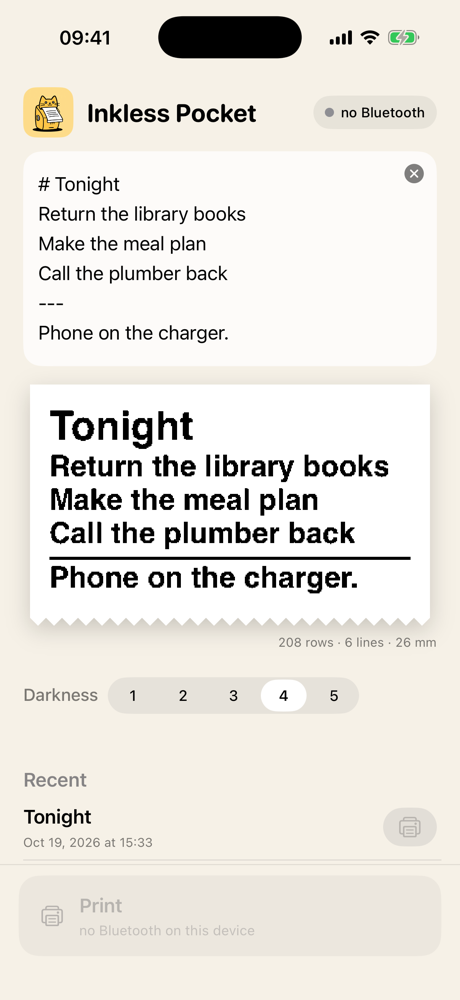
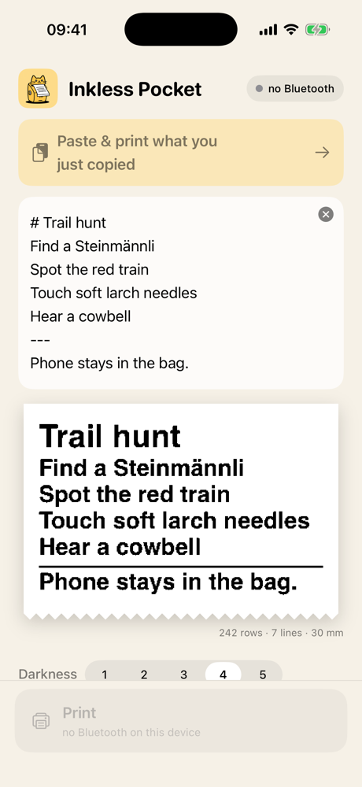

# Inkless Pocket

A tiny iPhone app for the little cat-faced Bluetooth thermal printers. Paste or type a few lines, see exactly
what the slip will look like, and print it. No account, no cloud, no tracking: the app talks to the printer
over Bluetooth and keeps nothing but your settings and last ten slips, on the phone.

<p>
  
  
</p>

<sub>Screenshots from the simulator, which has no Bluetooth; on a phone the button says Print.</sub>

It was built for one ritual: printing the evening's to-do list at the end of the workday, so the list can live
in a notebook instead of on the phone.

## Printers

Written and tested against the **JK01**, one of the printers in the **MXW01** family (Bluetooth service
`AE30`). The app connects to any printer that is named `JK01` or advertises that service, so other MXW01-class
printers will likely work too. If yours does (or doesn't), an issue with the model name is very welcome.

The older "GB01/GT01"-style cat printers speak a different protocol and are not supported.

## What it does

- **Preview that is the print.** The preview is the very bitmap that is sent to the printer.
- **Paste & print.** Copy text anywhere, open the app, tap the button that appears.
- **Two bits of markup, on purpose.** A line starting with `# ` prints big; a line that is only `---` draws a rule.
  Everything else is plain text, wrapped to the paper (384 dots wide).
- **Darkness** from 1 to 5, and your last ten slips to reprint or delete.
- **Shortcuts.** The app adds a "Print with Inkless Pocket" action. Put it in a Shortcut that accepts text from
  the share sheet, and you can share text from any app straight to the printer.

Press the printer's button to wake it; it dozes off after a few minutes.

## Build it

There is no App Store version. To install it on your own iPhone you need a Mac with Xcode and
[XcodeGen](https://github.com/yonaskolb/XcodeGen) (`brew install xcodegen`):

1. In `project.yml`, set `bundleIdPrefix` and `PRODUCT_BUNDLE_IDENTIFIER` to something of your own, and
   `DEVELOPMENT_TEAM` to your Apple team ID (a free Apple ID works; the app then needs reinstalling every 7 days).
2. Run `xcodegen` to generate `InklessPocket.xcodeproj`, open it, pick your iPhone and press Run.

The protocol and rendering live in the `InklessKit` Swift package, with tests: `cd InklessKit && swift test`.

## Print from a Mac

`tools/mxwprint.py` is a small reference printer in Python that speaks the same protocol:

```sh
pip install bleak pillow
python3 tools/mxwprint.py "hello"          # press the printer's button first
python3 tools/mxwprint.py "hi" --png out.png   # preview without printing
```

## The protocol, in short

GATT service `AE30`: `AE01` takes control packets, `AE02`/`AE04` notify, `AE03` takes raster data. Packets are
`22 21 op 00 len16 payload crc8 FF` with CRC-8 (poly `0x07`). A print is: density (`A2`), start (`A9`, wait for
its answer), rows of 48 bytes LSB-first in chunks of up to 180 bytes, then wait for `AA` (done) and keep the link
up for about two seconds. One warning: on the JK01 the status query `A3` feeds paper, so don't poll it.
`InklessKit/Sources/InklessKit/MXW01.swift` is the readable version.

## Acknowledgments

No code was copied; the protocol was learned from these projects and then verified on the device:

- **[TiMini-Print](https://github.com/Dejniel/TiMini-Print)** (Apache-2.0): the MXW01 packet format and the
  pause/resume flow-control frames.
- **[CatPrinterBLE](https://github.com/MaikelChan/CatPrinterBLE)** by MaikelChan (MIT): the MXW01 print sequence.
- **[Moblin](https://github.com/eerimoq/moblin)** by eerimoq (MIT): MXW01 over CoreBluetooth in Swift.
- **[cataclysm](https://github.com/s8n/cataclysm)** (MIT): protocol notes.
- **[mxw01-thermal-printer](https://github.com/clementvp/mxw01-thermal-printer)** by clementvp: protocol notes
  (no license published; consulted, nothing reused).

The app icon was generated locally with FLUX.1 [schnell] (Apache-2.0). Slips are rendered with the system's
Helvetica; the app bundles no fonts and no third-party code.

## License

[MIT](LICENSE) © 2026 Sarah Mennicken
